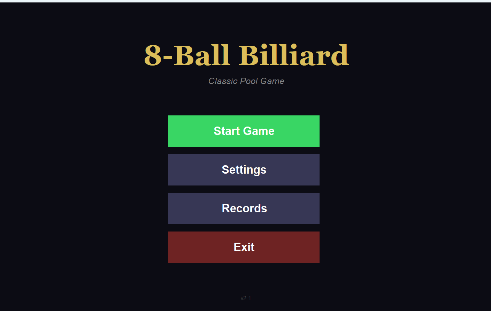
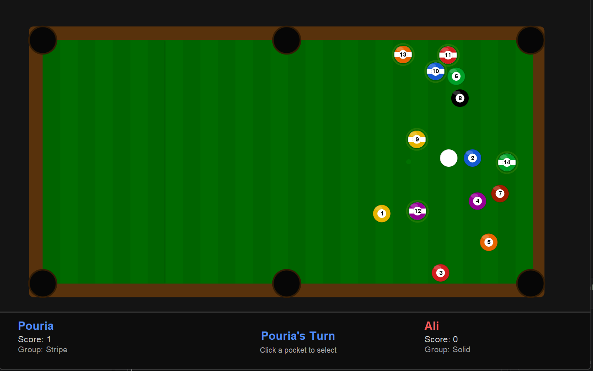
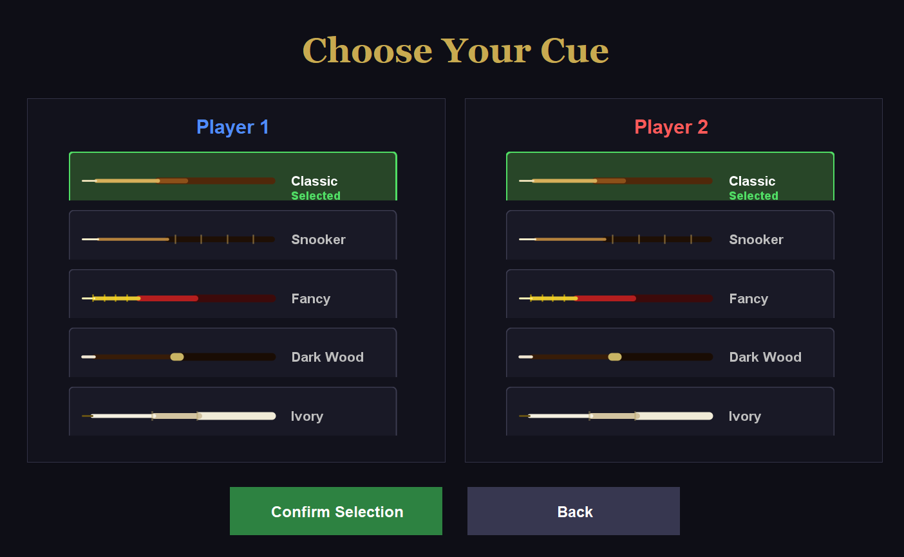
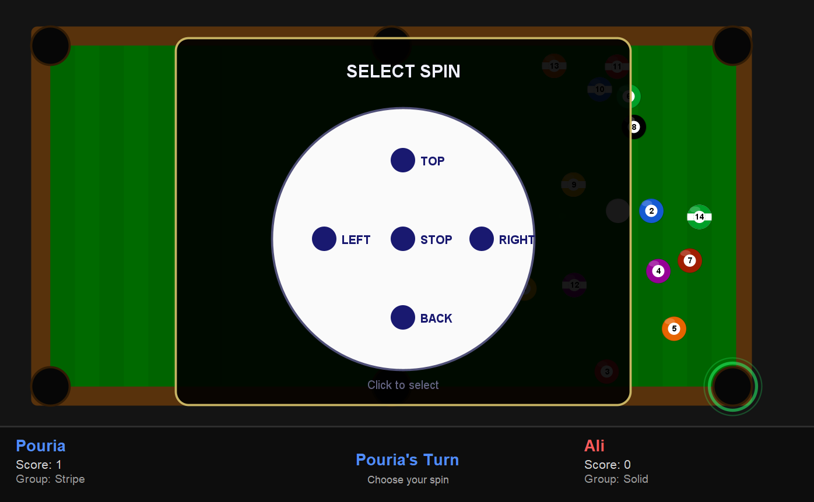
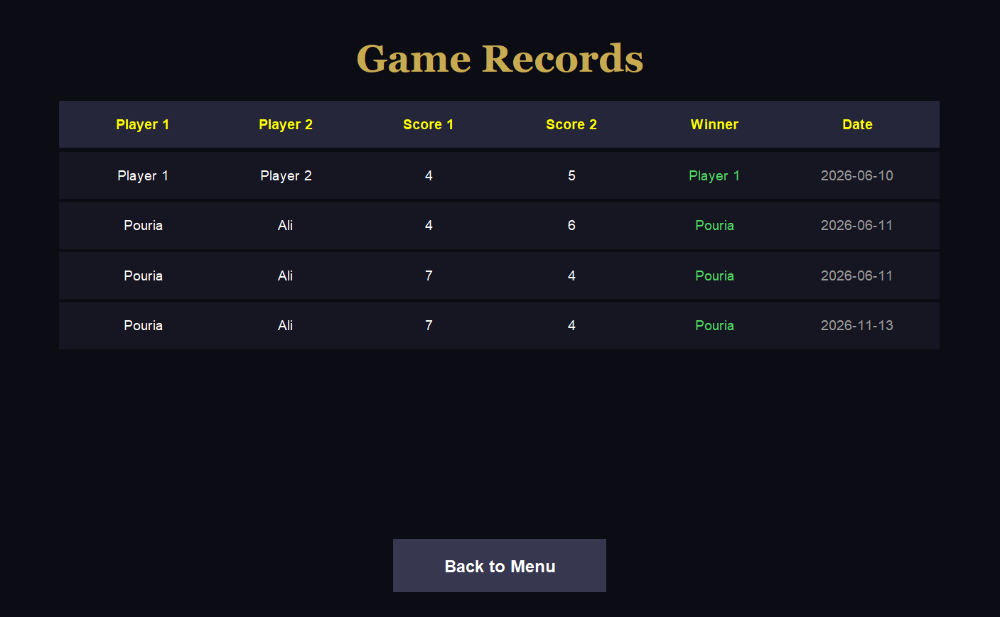
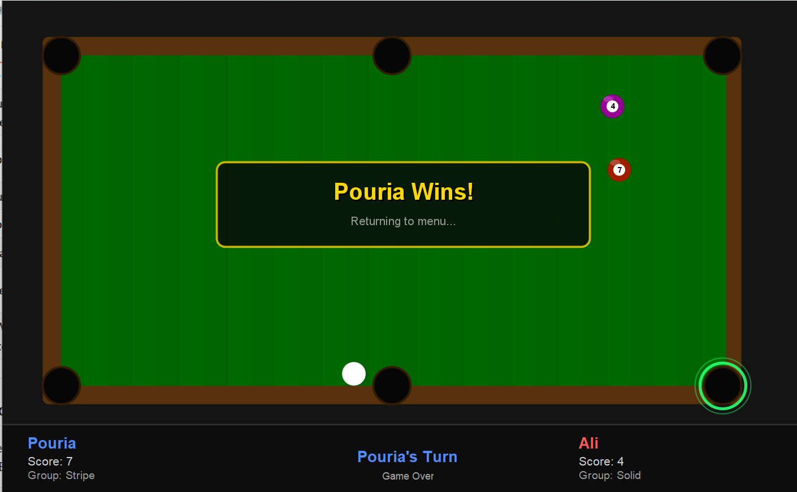

# 🎱 8-Ball Pool — Java Swing


> A two-player 8-ball pool game with realistic physics, spin control, and a clean MVC architecture — built entirely with Java Swing.

---

## 📖 About the Game

**8-Ball Pool** is a desktop billiard game for **two players**, written in pure Java with the **Swing** GUI toolkit. It simulates the classic 8-ball rules with a custom **physics engine** — ball collisions, friction, pocket detection, and **spin (English) mechanics** are all implemented from scratch without any external game engine.

The project was built to practice **Object-Oriented Programming**, the **MVC pattern**, and **real-time physics simulation** in Java.

---

## ✨ Features

| Category | Details |
|---|---|
| **Two-Player Mode** | Local pass-and-play — take turns pocketing your group (solids/stripes) and finish with the 8-ball. |
| ⚙️ **Custom Physics Engine** | Ball-to-ball and ball-to-cushion collisions, friction decay, and pocket detection — all hand-written (`PhysicsEngine`, `CollisionHandler`). |
| **Spin Control** | Apply **left/right spin (English)** to the cue ball — the aim line and cue stick preview update accordingly. |
| **Cue Selection** | Choose from **multiple cue types** (different power/feel) in the pre-game menu. |
| **Sound Effects** | Collision, pocket, foul, and win sounds — with a **sound on/off toggle** in settings. |
| **Match Records** | Every finished match is saved to `records.txt` with player names, scores, and winner. |
| 🎨 **Clean Swing UI** | Main menu, cue selection screen, live HUD with player info, and post-game announcement panel. |
| **MVC Architecture** | `model` / `view` / `controller` packages are cleanly separated, with a dedicated `physics` package. |

---

## 📸 Screenshots

All screenshots live in the **`screenshots/`** folder at the repo root.

| Main Menu | Gameplay |
|---|---|
|  |  |

| Cue Selection | Spin Controls |
|---|---|
|  |  |

| Records | Win Screen |
|---|---|
|  |  |

---

## 🚀 How to Run

### Prerequisites

- **JDK 17 or newer** (the project is tested with JDK 17+).

Verify with:
```bash
java -version
```

### Option 1: Gradle (Recommended)

```bash
# Linux / macOS
./gradlew run

# Windows
gradlew.bat run
```

To build a runnable JAR:
```bash
./gradlew jar
# Output: build/libs/8-ball-pool-2.1.jar
java -jar build/libs/8-ball-pool-2.1.jar
```

### Option 2: Plain Java (javac)

```bash
# From the project root
javac -d out $(find src -name "*.java")
java -cp out Main
```

> **Note:** The `sounds/` folder and `settings.properties` must remain in the same working directory, because the game loads them at runtime.

---

## 🎮 Gameplay Guide

1.  **Start a match** — both players enter their names on the main menu.
2.  **Choose a cue** — pick a cue type; each has a slightly different feel.
3.  **Break** — the first player breaks the rack.
4.  **Assign groups** — the first ball legally pocketed after the break decides whether you’re **solids (1–7)** or **stripes (9–15)**.
5.  **Take turns** — pocket a ball from your group to keep your turn. Miss or foul, and the turn passes.
6.  **Fouls** — pocketing the cue ball, hitting the wrong ball first, or failing to hit any ball results in a foul (opponent gets ball-in-hand).
7.  **Win** — pocket all your group’s balls first, then legally pocket the **8-ball** to win.

> Standard 8-ball rules apply: if you pocket the 8-ball early or on a foul, you lose.

---

## 🕹️ Controls

| Action | Input |
|---|---|
| Aim | Move the mouse around the cue ball |
| Adjust shot power | Drag the cue stick backward / forward |
| Apply spin | Use the **left/right spin selector** in the HUD |
| Shoot | Release the mouse (or click, depending on the shot mode) |
| Toggle sound | Settings menu → Sound On/Off |

---

## 🛠️ Technologies Used

| Technology | Purpose |
|---|---|
| **Java 17+** | Core language |
| **Java Swing** | GUI framework (JFrames, JPanels, custom `Graphics2D` painting) |
| **Java Sound API** | Sound effects (`javax.sound.sampled`) |
| **Custom Physics** | Vector math (`Vector.java`), collision resolution (`CollisionHandler.java`), friction & pocket logic (`PhysicsEngine.java`) |
| **MVC Architecture** | Clean separation of concerns (`model` / `view` / `controller` + `physics`) |
| **Gradle** | Build & dependency management (with wrapper included) |

---

## 📁 Project Structure

```
8-ball-pool/
├── src/
│   ├── Main.java                  # Entry point
│   ├── controller/
│   │   ├── GameController.java    # Game loop, turn logic, rules
│   │   └── DatabaseController.java# Records read/write (records.txt)
│   ├── model/
│   │   ├── Ball.java
│   │   ├── Table.java
│   │   ├── Pocket.java
│   │   ├── Player.java
│   │   ├── GameState.java
│   │   ├── GameRecord.java
│   │   ├── CueType.java
│   │   └── SpinType.java
│   ├── physics/
│   │   ├── PhysicsEngine.java     # Friction, pocket checks, updates
│   │   ├── CollisionHandler.java  # Ball–ball & ball–cushion collisions
│   │   └── Vector.java            # 2D vector math
│   └── view/
│       ├── MainFrame.java         # Main window & panel switching
│       ├── MainMenuPanel.java
│       ├── CueSelectionPanel.java
│       ├── CuePreviewCard.java
│       ├── CueStick.java
│       ├── GamePanel.java         # Table rendering + input
│       ├── AimLineRenderer.java
│       ├── PlayerInfoPanel.java
│       ├── RecordsPanel.java
│       └── Announcement.java
├── sounds/                        # .wav sound effects
├── screenshots/                   # README screenshots
├── build.gradle                   # Gradle build script
├── settings.gradle
├── gradlew / gradlew.bat
├── gradle/wrapper/
├── .gitignore
└── README.md
```

---

## 🤝 Contributing

1.  Fork the repo.
2.  Create a branch: `git checkout -b feature/my-feature`.
3.  Commit your changes: `git commit -m "Add my feature"`.
4.  Push: `git push origin feature/my-feature`.
5.  Open a Pull Request.

Please keep the **MVC separation** intact — put rendering logic in `view/`, rules in `controller/`, state in `model/`, and physics in `physics/`.

---

## 📄 License

This project is licensed under the **MIT License** — see the [LICENSE](LICENSE) file for details.